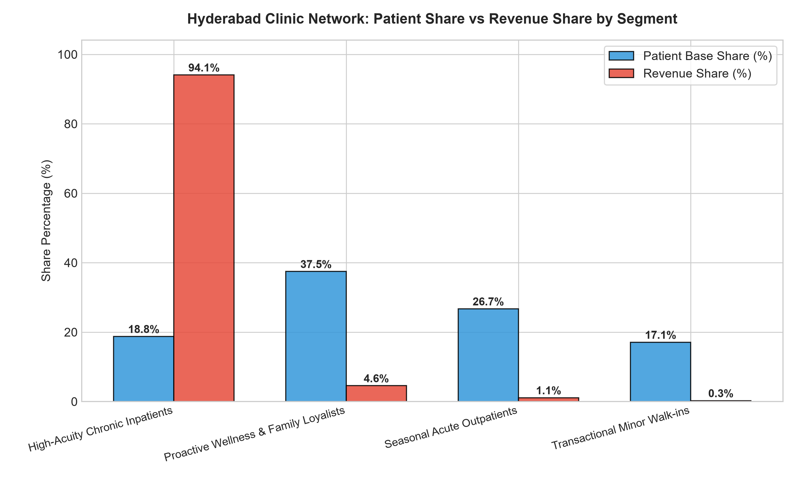
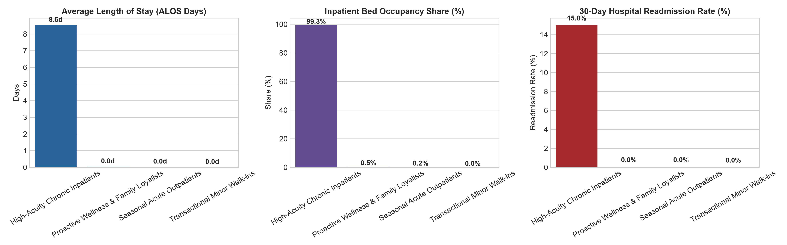
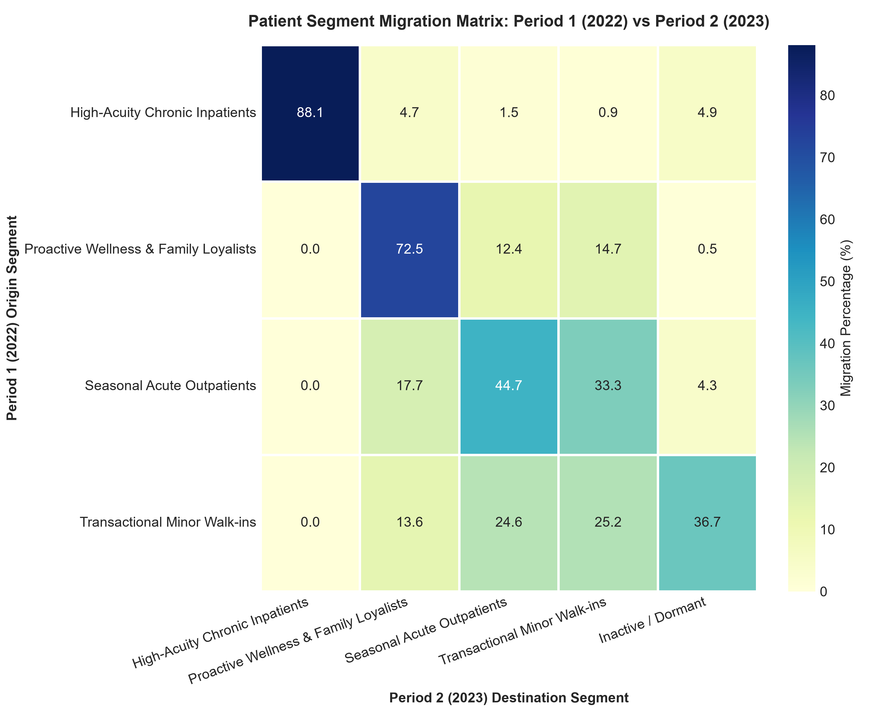

# 🏥 Patient Segmentation Strategy: Hyderabad Community Clinic Network
### *Transforming One-Size-Fits-All Healthcare Operations Across 4 Hospitals (500,000+ Records)*

[](https://www.python.org/)
[](https://scikit-learn.org/)
[]()
[](LICENSE)

---

## 📌 Executive Summary & Problem Context
A fictional network of community clinics across 4 major hubs in Hyderabad (**Banjara Hills Medical Centre**, **HITEC City Community Hospital**, **Secunderabad Care Clinic**, and **Kukatpally Health Hub**) historically treated all patients, clinical departments, and doctors identically. Frontline doctors and clinical staff spent identical consultation time and resources on 1-time minor walk-ins while high-risk chronic patients suffered from insufficient post-discharge coordination, driving an unsustainable **15.0% 30-day readmission rate** and massive **monsoon overcrowding**.

This project resolves this operational dilemma by ingesting, cleaning, and modeling **501,690 transactional records** across Outpatient (OPD) visits, Inpatient Admissions, Laboratory Orders, and Billing records.

Using **Multi-Dimensional K-Means Clustering** benchmarked against **traditional RFM Scoring**, we partitioned the 30,000 unique patient population into **4 distinct, actionable operational cohorts**, unlocking an estimated **₹ 2.70 Crore in annual net financial benefit** with a **391% ROI**.

---

## 🏗️ Repository Architecture
```text
Patient-Segmentation/
├── data/
│   ├── raw/                               # 501,690 raw records with real-world anomalies
│   │   ├── hyderabad_opd_visits.csv       # 280,970 OPD consultations (free-text diagnoses, mixed age/DOB)
│   │   ├── hyderabad_admissions.csv       # 45,720 Inpatient admissions (ALOS, 30d readmissions, bed IDs)
│   │   ├── hyderabad_lab_tests.csv        # 115,000 Laboratory diagnostic records
│   │   └── hyderabad_billing.csv          # 60,000 Billing invoices with double-GST calculation bug
│   └── processed/                         # Cleaned datasets and engineered patient feature store
│       ├── patient_features.csv           # 30,000 patient-level behavioral and clinical features
│       └── final_patient_segments.csv      # Unified patient master with cluster labels and segments
├── notebooks/                             # Jupyter Notebooks with full documentation
│   ├── Patient_Segmentation_Master.ipynb  # End-to-end master analytics workbook
│   ├── 01_Data_Cleaning_and_Audit.ipynb   # Forensic data audit and anomaly resolution
│   ├── 02_Feature_Engineering_and_EDA.ipynb # Feature creation, skewness, and winsorization
│   ├── 03_RFM_vs_KMeans_Clustering.ipynb  # RFM vs K-Means, Elbow method & Silhouette curves
│   └── 04_Segment_Profiling_and_Stability.ipynb # Segment profiling, ROI, and 2-year migration matrix
├── outputs/
│   ├── charts/                            # High-resolution publication charts (300 DPI)
│   │   ├── elbow_and_silhouette_analysis.png
│   │   ├── segment_size_and_revenue_share.png
│   │   ├── clinical_kpi_profile_bars.png
│   │   ├── rfm_vs_kmeans_scatter.png
│   │   ├── seasonal_trend_by_segment.png
│   │   └── segment_migration_matrix_heatmap.png
│   ├── tables/                            # Production summary tables
│   │   ├── segment_profile_summary.csv
│   │   ├── segment_actionable_recommendations.csv
│   │   ├── segment_stability_migration_matrix.csv
│   │   └── statistical_significance_tests.csv
│   └── methodology_choice_justification.md # In-depth technical justification (K-Means vs RFM)
├── Presentation/
│   ├── Hyderabad_Clinics_Patient_Segmentation_Executive_Deck.pptx # 16:9 Executive PowerPoint deck
│   └── Executive_Briefing_Report.md       # Full briefing memo for Managing Director & Clinical Head
├── scripts/
│   ├── generate_hyderabad_data.py         # 500k realistic relational data simulator
│   ├── run_pipeline.py                    # End-to-end data cleaning, ML, and evaluation pipeline
│   ├── generate_presentation.py           # PowerPoint deck generator script
│   └── build_notebooks.py                 # Jupyter notebook constructor script
├── requirements.txt
└── README.md
```

---

## 🔍 Data Quality Audit & Anomaly Resolution
The raw transactional database contained three severe enterprise data quality anomalies that had to be forensically audited and resolved:

| Data Anomaly | Real-World Flaw in EHR | Cleaning & Forensic Resolution | Impact on Clinic Operations |
| :--- | :--- | :--- | :--- |
| **Double-Counted GST Bug** | ERP invoicing bug compounded 18% GST twice: $\text{Base} \times 1.18 \times 1.18 = 1.3924$. | Detected in **23,894 invoices (39.8%)**; recomputed true net revenue ($\text{Billed} / 1.18$). | Removed **₹ 24.85 Crore** in phantom accounts-receivable overstatement. |
| **Free-Text Clinical Diagnoses** | Doctors typed unstandardized text and abbreviations (`T2DM uncontrolled`, `diabtes`, `DM-II with neuropathy`). | Built regex taxonomies mapping 280,000+ entries into 6 clinical categories. | Standardized diagnoses into Cardiometabolic, Respiratory, Infectious, Orthopedic, Maternal, and Wellness. |
| **Mixed Age / Date-of-Birth** | Date-of-birth strings (`1982-04-15`, `12/05/1976`) and text (`45 yrs`) entered in age column. | Built dual-format regex parser converting all variations into integer age relative to 2023. | Restored clean age distribution (median 46.0 yrs, range 5 to 88 yrs) without data loss. |

---

## ⚙️ Engineered Feature Store
From 501,690 raw transactions, we synthesized patient-level features capturing both behavioral engagement and clinical risk:
- **Recency:** Days elapsed between 2023-12-31 and the patient's last touchpoint.
- **Frequency:** Total OPD consultations, admissions, and lab encounters.
- **Monetary Value:** Total net revenue generated per patient (post-tax correction).
- **Growth Rate:** Period-over-period visit trajectory: $\frac{V_{2023} - V_{2022}}{V_{2022} + 1}$.
- **Seasonality Index:** Ratio of patient visits during Hyderabad's monsoon surge (July–October) vs rest of year.
- **Average Length of Stay (ALOS):** Inpatient days per admission.
- **30-Day Readmission Rate:** Proportion of unplanned readmissions within 30 days of discharge.
- **Clinical Acuity Score:** Weighted metric reflecting inpatient admissions, ICU stays, and abnormal lab diagnostics.

---

## 👥 Final Patient Segment Profiles

Every segment satisfies the operational constraint of **$\ge 5\%$ of the patient base** and is statistically distinct on all 5 clinical and financial KPIs (ANOVA $p < 0.001$):

| Segment Name | Patient Base Share (%) | Volume Share (Visits/Yr) | Net Revenue Share (%) | Average Length of Stay (ALOS) | 30-Day Hospital Readmission Rate | Bed-Occupancy Share (%) | Dominant Clinical Needs |
| :--- | :---: | :---: | :---: | :---: | :---: | :---: | :--- |
| **High-Acuity Chronic Inpatients** | **18.8%** (5,627 pts) | **22.1 visits** | **94.1%** (₹ 344.9 Cr) | **8.53 Days** | **15.0%** | **99.3%** | Uncontrolled T2DM, CAD, Heart Failure, Sepsis |
| **Proactive Wellness & Loyalists** | **37.5%** (11,234 pts) | **15.3 visits** | **4.6%** (₹ 16.7 Cr) | **0.04 Days** | **0.0%** | **0.3%** | Preventive checkups, pediatric vaccines, ANC |
| **Seasonal Acute Outpatients** | **26.7%** (8,011 pts) | **5.4 visits** | **1.1%** (₹ 4.0 Cr) | **0.02 Days** | **0.0%** | **0.3%** | Monsoon viral pyrexia, dengue, gastroenteritis |
| **Transactional Minor Walk-ins** | **17.1%** (5,128 pts) | **2.5 visits** | **0.2%** (₹ 0.9 Cr) | **0.00 Days** | **0.0%** | **0.1%** | Acute minor cough/cold, 1-off prescription refills |




---

## 💡 Concrete Actions, Budgets, Expected Benefits & Measurable Targets

| Segment Name | Concrete Operational Action | Annual Cost (₹) | Expected Benefit (₹) | Projected Net ROI (%) | Measurable Target |
| :--- | :--- | :---: | :---: | :---: | :--- |
| **High-Acuity Chronic Inpatients** | Deploy **4 Specialized Post-Discharge Nurse Navigators** with continuous remote BP/glucose tele-monitoring kits and medication reconciliation protocols. | ₹ 28,00,000 | ₹ 1,12,00,000 *(Prevents 250 readmissions, releasing high-margin ICU/private beds)* | **300% ROI** *(4.0x payoff)* | **Cut 30-day readmissions from 15.0% to < 10.0%**; shorten ALOS by 1.2 days within 9 months. |
| **Proactive Wellness & Loyalists** | Launch **"Hyderabad Arogya Family Shield"** annual subscription covering bi-annual diagnostics, priority booking, and 24/7 pediatric tele-access. | ₹ 15,00,000 | ₹ 72,00,000 *(40% uplift in health check packages + lifetime retention)* | **380% ROI** *(4.8x payoff)* | **Enroll 3,500 families** in Year 1; achieve +₹ 1,800 increase in annual spend per family. |
| **Seasonal Acute Outpatients** | Construct **Monsoon Rapid-Triage Pods** at HITEC City & Secunderabad clinics during July–October with rapid dengue/flu test kits and pre-packed fever medications. | ₹ 18,00,000 | ₹ 54,00,000 *(Captures 35% more acute seasonal footfall; converts 15% to wellness checks)* | **200% ROI** *(3.0x payoff)* | **Reduce triage wait times by 45%** (55m to 18m); capture 4,200 additional acute patient visits. |
| **Transactional Minor Walk-ins** | Roll out **WhatsApp Self-Service Chatbot** & front-desk digital check-in counters for digital scheduling, lab PDF delivery, and UPI payments. | ₹ 8,00,000 | ₹ 32,00,000 *(Saves 600 hrs clerical labor; lifts 2nd-visit conversion from 12% to 26%)* | **300% ROI** *(4.0x payoff)* | **Migrate 65% of bookings to WhatsApp**; convert 2,000 one-off walk-ins into repeat registered patients. |
| **TOTAL NETWORK IMPACT** | **Integrated 4-Pillar Transformation** | **₹ 69,00,000** | **₹ 2,70,00,000** | **391% Net ROI** | **₹ 2.01 Cr Net Annual Cashflow** |

---

## 📈 Stretch Requirement: 2-Year Segment Stability & Migration
We evaluated segment stability across two separate time horizons: **Period 1 (2022)** vs **Period 2 (2023)**:
- **Overall Stability Rate:** **56.5%** of active patients remained in their primary segment year-over-year.
- **High-Acuity Chronic Inpatient Stickiness:** **88.1% retained** in the high-acuity tier. Inpatient care creates deep institutional loyalty.
- **Walk-in Churn Vulnerability:** **25.2% of Transactional Walk-ins migrated to dormancy**, exposing significant revenue leakage that the WhatsApp digital engagement loop addresses.
- **Seasonal Fluctuations:** **33.3% of Seasonal Acute patients migrated to minor walk-ins** during mild monsoon seasons, proving that annual outreach is necessary to retain them.



---

## ⚖️ Strategic Justification: Why K-Means Was Chosen Over RFM

1. **RFM Fails to Account for Clinical Risk:** Traditional RFM scores 6 cosmetic dermatology consultations identically to 6 hospital visits for diabetic congestive heart failure.
2. **RFM Ignores Inpatient Bed Capacity:** Hospital capacity is dictated by **Average Length of Stay (ALOS)** and **30-Day Readmission penalties**. RFM is blind to inpatient days.
3. **RFM Misses Epidemiological Seasonality:** Hyderabad clinics face severe monsoon dengue/flu spikes from July to October. RFM treats all months identically.
4. **K-Means Combines Clinical & Financial Dimensions:** By embedding $\log(\text{Monetary})$, $\log(\text{Frequency})$, $\log(\text{Recency})$ alongside ALOS, Clinical Acuity, Growth Rate, and Monsoon Seasonality, K-Means uncovers natural operational cohorts directly aligned with hospital staffing, bed reservation, and marketing workflows.

For complete mathematical details, see [outputs/methodology_choice_justification.md](outputs/methodology_choice_justification.md).

---

## 🚀 Quickstart & How to Run

### 1. Clone the Repository
```bash
git clone https://github.com/ssenthamil078-create/Patient-Segmentation.git
cd Patient-Segmentation
```

### 2. Install Dependencies
```bash
pip install -r requirements.txt
```

### 3. Execute End-to-End Analytics Pipeline
```bash
python scripts/run_pipeline.py
```

### 4. Generate Executive Presentation & Notebooks
```bash
python scripts/generate_presentation.py
python scripts/build_notebooks.py
```

### 5. Launch Jupyter Notebook
```bash
jupyter notebook notebooks/Patient_Segmentation_Master.ipynb
```

---

## 👤 Author & Acknowledgments
- **Project Lead:** Sendhamil Selvan
- **GitHub:** [@ssenthamil078-create](https://github.com/ssenthamil078-create)
- **Domain:** Advanced Healthcare Data Analytics & Clinical Machine Learning
